# Blackjack Trainer — Interaction Flows

All steps below are taken directly from the engine and UI code (file:line references included) rather than assumed from typical blackjack-app behavior.

---

## Feature: Place a Bet & Deal
Goal: Wager chips and see your starting hand.

Flow:
1. User does: Taps a chip in the betting tray.
   - App responds by: `addToBet()` → `setBet()` clamps the bet to between $0 and the lower of the table maximum and the current bankroll ([game.js:83-92](../src/engine/game.js)).
   - Data/API/database involved: `game.betCents`.
   - Result: The bet stack grows on screen; a chip sound plays.
2. User does: Taps "Deal" (only enabled once `canDeal()` is true — bet ≥ table minimum and ≤ bankroll) ([game.js:99-105](../src/engine/game.js)).
   - App responds by: If the shoe needs reshuffling (penetration reached) or the deck count was changed in Settings, the app first pauses 2 seconds on a "RESHUFFLE" overlay with a shuffle sound. Then `deal()` commits the stake and deals cards in order: player, dealer-up, player, dealer-hole ([game.js:131-159](../src/engine/game.js)). It then checks whether to offer insurance, and peeks for a dealer/player blackjack.
   - Data/API/database involved: `game.bankrollCents`, `game.playerHands`, `game.dealerCards`, `shoe.seenCards`.
   - Result: Cards animate onto the table; the game moves to the Insurance prompt, the player's turn, or directly to a round result.

Decision points:
- If the dealer's up-card is an Ace, insurance is enabled in the rules, and the bankroll covers half the bet → the Insurance prompt appears.
- If the dealer's up-card is an Ace or a ten-value card, the dealer peeks; a dealer blackjack ends the round immediately (insurance pays 2:1 if taken).
- If the player has blackjack and the dealer doesn't, the round also ends immediately with a 3:2 (or configured) payout.
- Otherwise, play continues to the player's turn.

Possible errors or edge cases:
- Bet below the table minimum or above the bankroll → the Deal button stays disabled; no error message is shown.
- Bankroll can't cover the table minimum at all → chips/Deal aren't available; an "Out of chips" message and Re-buy button appear instead (see *Out of Chips / Re-buy*).
- Shoe at its reshuffle point → automatic 2-second "RESHUFFLE" pause before dealing ([controls.js:175-193](../src/ui/controls.js)).

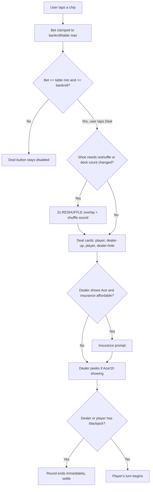

---

## Feature: Hit
Goal: Take another card on the current hand.

Flow:
1. User does: Taps "Hit" (enabled only while `canHit()` is true: player's turn, hand not finished, total under 21) ([game.js:349-353](../src/engine/game.js)).
   - App responds by: `hit()` draws one card into the active hand and marks it as seen for the count ([game.js:220-229](../src/engine/game.js)).
   - Data/API/database involved: active hand's `cards`, `shoe.seenCards`.
   - Result: A new card animates in and the hand's total updates.

Decision points:
- If the new total is 21 or more (21 exactly, or a bust over 21), the hand auto-completes and play advances to the next unfinished hand, or to the dealer if none remain.

Possible errors or edge cases:
- None beyond the Hit button being disabled when not legal — no separate error message.

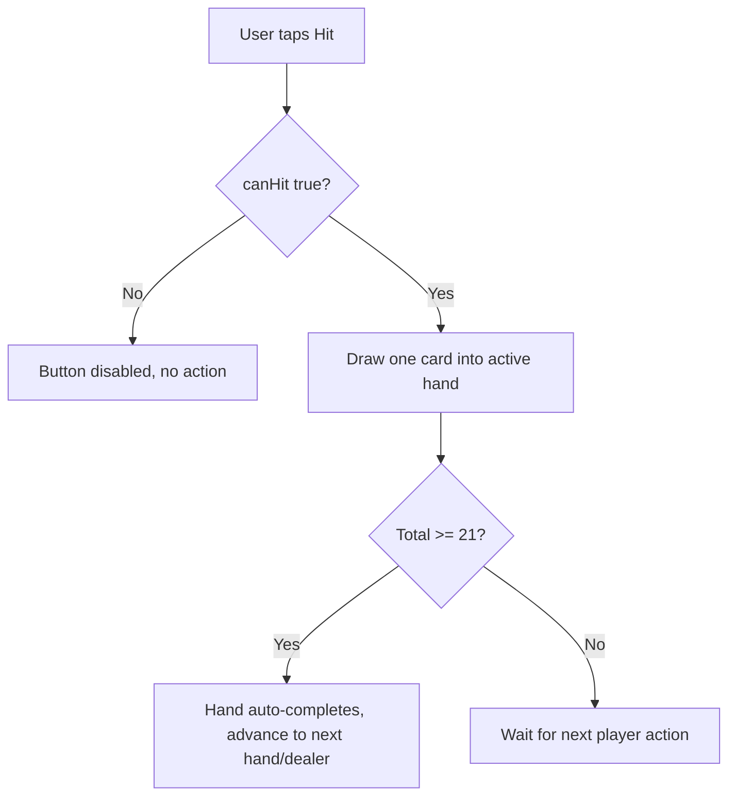

---

## Feature: Stand → Dealer's Turn → Settlement
Goal: End your turn and see the dealer's hand and the result.

Flow:
1. User does: Taps "Stand" (enabled while `canStand()` is true) ([game.js:355-359](../src/engine/game.js)).
   - App responds by: `advanceHand()` moves to the next unfinished hand (relevant after a split), or — once all hands are done — plays out the dealer ([game.js:267-285](../src/engine/game.js)).
   - Result: Either the next split hand becomes active, or the dealer's hole card is revealed.
2. User does: (no further input — the dealer plays automatically.)
   - App responds by: The hole card is revealed and counted; if at least one player hand is still alive (not bust), the dealer draws according to the configured hit/stand-on-soft-17 rule until done ([game.js:287-296](../src/engine/game.js)).
   - Result: `settleRound()` compares every hand to the dealer's final total and credits/debits the bankroll ([game.js:299-313](../src/engine/game.js)); a result overlay appears (WON / BLACKJACK! / PUSH / DEALER WINS / SURRENDERED).

Decision points:
- The dealer does not draw at all if every player hand has already busted.
- Each split hand settles independently against the same dealer hand.

Possible errors or edge cases:
- None — settlement is deterministic given the final hands; there is no failure path here.

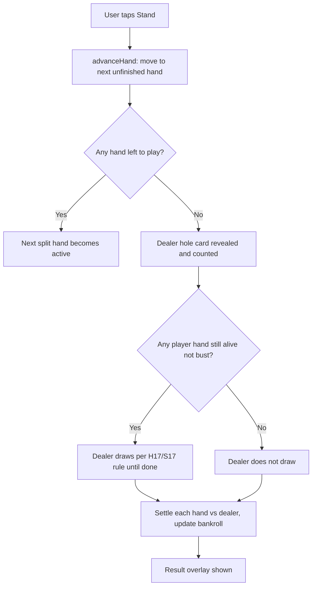

---

## Feature: Double Down
Goal: Double the wager for exactly one more card.

Flow:
1. User does: Taps "Double" (enabled only when `canDouble()` is true: exactly 2 cards, doubling allowed by the rules, the hand's total falls within the configured restriction, enough bankroll to match the stake, and — if from a split — double-after-split is allowed) ([game.js:361-371](../src/engine/game.js)).
   - App responds by: `double()` matches the original stake, deals exactly one card, and auto-stands the hand ([game.js:237-247](../src/engine/game.js)).
   - Data/API/database involved: active hand's `stakeCents`, `game.bankrollCents`.
   - Result: The stake visibly doubles, one card is dealt, and play moves to the next hand or the dealer.

Decision points:
- The double restriction ("any total" / hard 9–11 / hard 10–11) applies to **hard** totals only — a soft hand never qualifies when a restriction is configured.

Possible errors or edge cases:
- Insufficient bankroll, more than 2 cards, or outside the restriction → the Double button is simply disabled; no error message.

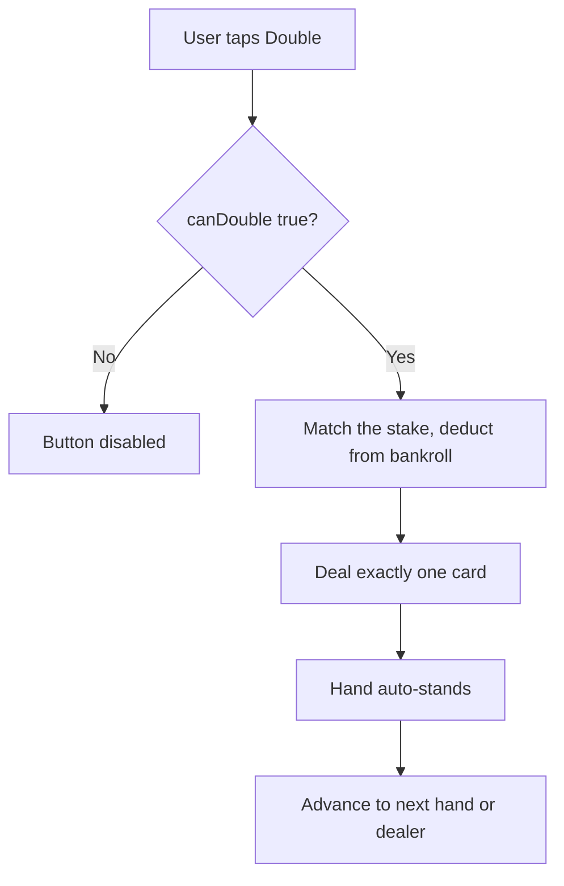

---

## Feature: Split
Goal: Split a starting pair into two independently played hands.

Flow:
1. User does: Taps "Split" (enabled only when `canSplit()` is true: 2 cards forming a pair, splitting allowed, under the configured max split-hands cap, enough bankroll for a matching second stake) ([game.js:373-384](../src/engine/game.js)).
   - App responds by: `split()` creates a new sibling hand immediately to the right, deals one new card to each of the two hands, and commits a matching stake ([game.js:406-433](../src/engine/game.js)).
   - Data/API/database involved: `game.playerHands` (new entry inserted), `game.bankrollCents`.
   - Result: The two original cards separate into two hand areas; play continues on the left hand first.

Decision points:
- Splitting a pair of Aces deals exactly one card to each new hand and stands both **immediately** — the app does not support hitting or re-splitting Aces.
- A 21 made on a hand that came from a split does **not** count as a blackjack (it pays even money via the `fromSplit` flag), unlike a natural 21 on the first two cards.

Possible errors or edge cases:
- Re-splitting beyond the configured cap, or insufficient bankroll for the second stake → the Split button is disabled silently.
- If the rules enable re-splitting/hitting Aces, the app's startup capability guard warns that this isn't implemented and the one-card-each behavior is used regardless ([validateRules.js:41-51](../src/engine/validateRules.js)).

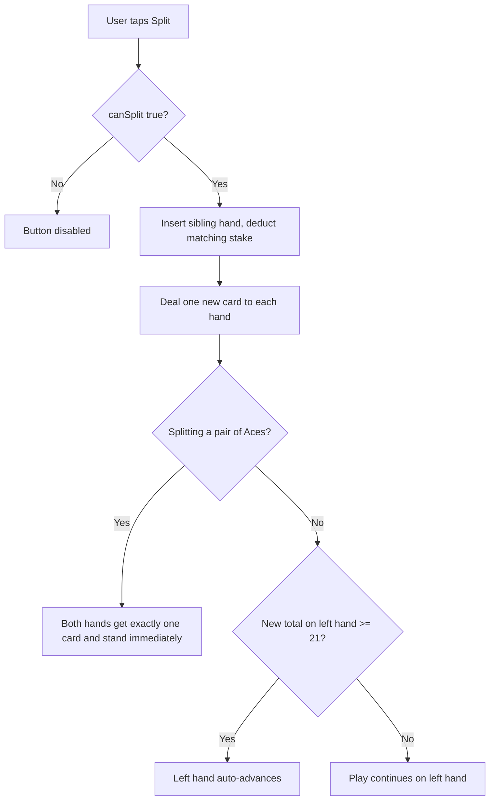

---

## Feature: Surrender (Late)
Goal: Forfeit half the bet to bail out of a bad hand immediately.

Flow:
1. User does: Taps the 🏳️ surrender button — shown only when `canSurrender()` is true: the rules allow late (or early, which falls back to late) surrender, this is the original two-card hand, no split has happened, and it's the very first decision ([game.js:386-393](../src/engine/game.js)).
   - App responds by: `surrender()` forfeits half the stake and ends the round without the dealer drawing ([game.js:255-265](../src/engine/game.js)).
   - Data/API/database involved: `hand.outcome`, `game.bankrollCents` (half the stake returned).
   - Result: A "SURRENDERED" result overlay appears.

Decision points:
- Surrender is only ever offered as the first action — once any other action (or a split) happens, the option disappears for the rest of that round.

Possible errors or edge cases:
- If `player.surrender` is configured as `'early'`, the app falls back to late surrender (offered after the dealer's peek) and the startup guard surfaces a warning, rather than silently behaving as true early surrender ([validateRules.js:35-39](../src/engine/validateRules.js)).

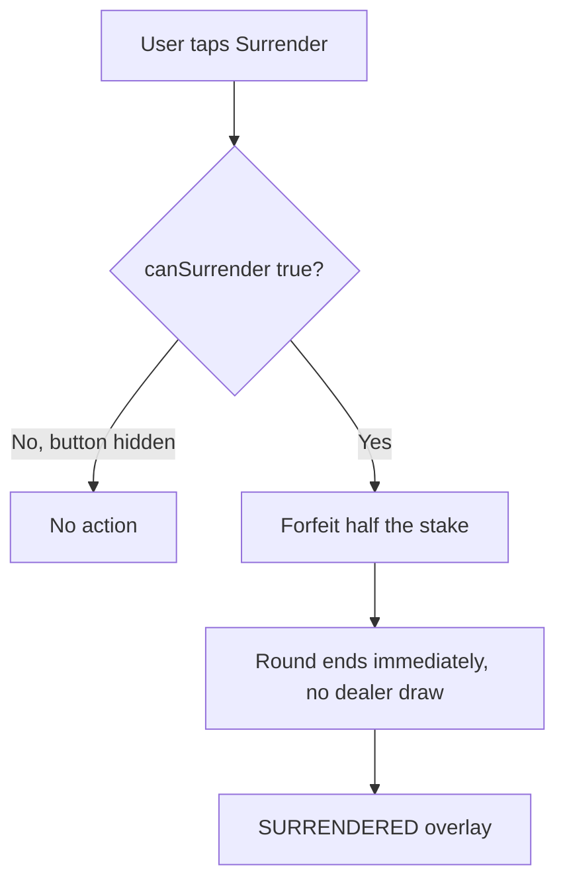

---

## Feature: Insurance
Goal: Hedge against a dealer blackjack when the up-card is an Ace.

Flow:
1. User does: (No action yet — the prompt appears automatically.)
   - App responds by: Right after dealing, if the dealer's up-card is an Ace, insurance is enabled in the rules, and the bankroll covers half the original bet, the phase becomes "Insurance" and a prompt appears ([game.js:165-176](../src/engine/game.js)).
   - Result: "Dealer shows an Ace — take insurance?" with "Insure $X" / "No" buttons.
2. User does: Taps "Insure $X" or "No".
   - App responds by: `takeInsurance()` deducts the side-bet cost; `declineInsurance()` skips it ([game.js:178-191](../src/engine/game.js)). Either way, the app proceeds to the peek/blackjack check.
   - Data/API/database involved: `game.insuranceCents`, `game.bankrollCents`.
   - Result: If insured and the dealer does have blackjack, insurance pays 2:1 ([game.js:205-208](../src/engine/game.js)); the main hand still resolves under normal blackjack-vs-blackjack rules.

Decision points:
- The prompt is silently never shown if the bankroll can't cover half the bet, even if the dealer shows an Ace.

Possible errors or edge cases:
- None beyond the bankroll-gated silent skip above.

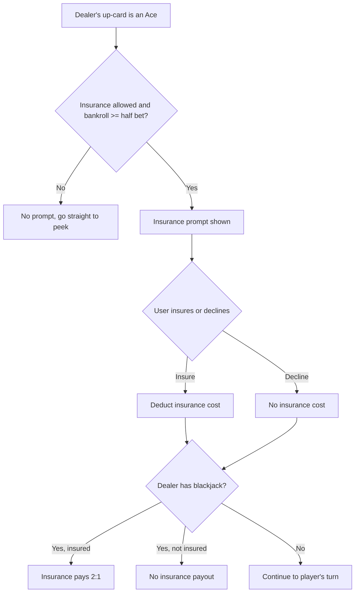

---

## Feature: View Strategy Hint
Goal: See the mathematically optimal move and why.

Flow:
1. User does: Taps the 💡 lightbulb during their turn (only shown if the rules enable strategy hints) ([render.js:177-180](../src/ui/render.js)).
   - App responds by: Computes `bestAction()` — the highest expected-value legal move among stand/hit/double/split/surrender — and `explainAction()` turns it into a plain-language sentence citing the actual computed numbers ([advisor.js:24-50](../src/teaching/advisor.js), [explain.js](../src/teaching/explain.js)).
   - Result: A panel shows the recommended move, the explanation, and a caveat to cross-check an authoritative chart.
2. User does: Plays a different action than recommended (if "warn on deviation" is enabled in the rules).
   - App responds by: A banner reads "Basic strategy here was **[recommended move]**" after the action is taken ([controls.js:195-201, 211-229](../src/ui/controls.js); [render.js:612-616](../src/ui/render.js)).
   - Result: Purely informational — the player's chosen action still goes through.

Decision points:
- The hint never overrides or blocks any action; it's advisory only.

Possible errors or edge cases:
- None — this is a read-only computation over the current hand.

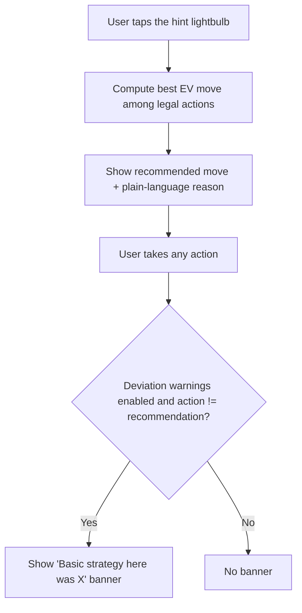

---

## Feature: View Card Count
Goal: Track the running and true count the way a real counter would.

Flow:
1. User does: Plays normally on a depleting shoe (not a continuous shuffler) with counting enabled in the rules.
   - App responds by: Continuously recalculates the Hi-Lo running count, true count (running ÷ decks remaining), and decks remaining from every card the player has actually seen ([counting.js](../src/teaching/counting.js); displayed at [render.js:389-408](../src/ui/render.js)).
   - Data/API/database involved: `shoe.seenCards`.
   - Result: A bar under the top bar shows the running count (green if favorable to the player, red if not), the true count, and decks remaining.
2. User does: (No action — happens automatically as cards are revealed.)
   - App responds by: The dealer's hole card is added to the count only the instant it's actually flipped face-up (at Stand or a natural), never when it's first dealt face-down ([game.js:65-80](../src/engine/game.js)).
   - Result: The displayed count stays consistent with what a player physically at the table could see.

Decision points:
- On reshuffle, the seen-cards list is cleared and the count returns to zero.
- The readout is hidden entirely when the shoe is configured as a continuous shuffler — counting is meaningless there.

Possible errors or edge cases:
- If the configured counting system isn't Hi-Lo, the app falls back to Hi-Lo (rather than silently computing the wrong system) and the startup guard surfaces a warning ([validateRules.js:54-63](../src/engine/validateRules.js)).

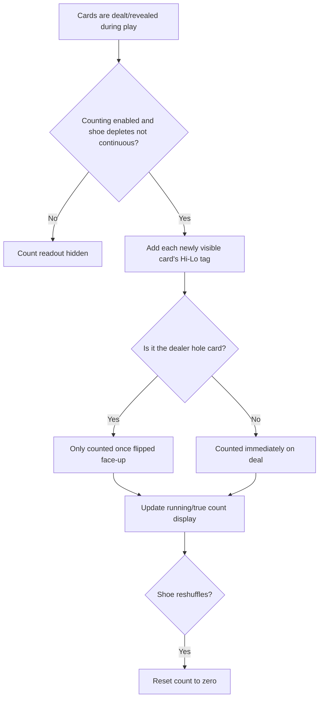

---

## Feature: Adjust Settings
Goal: Change soft-value display, deck count, or mute sound.

Flow:
1. User does: Taps ⚙️ to open Settings.
   - App responds by: Snapshots the current deck count for comparison later ([controls.js:107-117](../src/ui/controls.js)).
   - Result: The settings panel slides in.
2. User does: Toggles "Alternate soft value", taps the deck-count ▲/▼ stepper (clamped 1–99), or taps mute/unmute.
   - App responds by: Updates the setting and saves it to IndexedDB immediately ([controls.js:97-105, 124-139](../src/ui/controls.js)).
   - Result: Soft totals re-label instantly; the deck count in the rules chip updates live; sound is silenced/restored.
3. User does: Closes Settings (gear or tapping outside the panel).
   - App responds by: If the deck count differs from what it was when Settings opened, any hand currently in progress is abandoned (the stake is **forfeited, not refunded**), and a 2-second "RESHUFFLE" overlay with a shuffle sound plays before the shoe is rebuilt at the new size ([controls.js:59-81, 118-123](../src/ui/controls.js)).
   - Result: Settings panel closes; if a reshuffle fired, the table returns to a fresh betting state.

Decision points:
- If the deck count is changed and then changed back to its original value before closing, no reshuffle fires.

Possible errors or edge cases:
- A deck-count change mid-hand silently forfeits that hand's stake — there is no confirmation dialog warning the player before this happens.

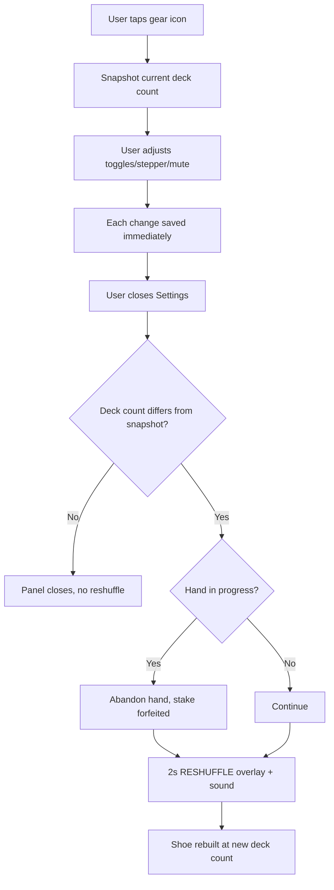

---

## Feature: Run a Betting Simulation
Goal: See whether a betting progression pays off over many sessions.

Flow:
1. User does: Taps 📊 to open the simulator screen.
   - App responds by: Swaps to a full-screen simulator view; this never touches the live game state ([controls.js:142-143](../src/ui/controls.js)).
   - Result: The simulator screen appears with the betting system / sessions / hands-per-session selectors.
2. User does: Picks a betting system (Martingale or Flat), a session count (1,000 / 2,000 / 5,000), and hands per session (50 / 100 / 200).
   - App responds by: Stores the selections in UI-only state ([controls.js:144-146](../src/ui/controls.js)).
3. User does: Taps "Run simulation".
   - App responds by: Immediately shows "Running…", then (after yielding to let that paint) plays the chosen number of sessions headlessly through the real game engine — each hand decided by the same optimal-strategy logic as the hint feature, with the betting system only choosing the wager size ([controls.js:147-165](../src/ui/controls.js); [simulator.js:117-171](../src/sim/simulator.js)).
   - Data/API/database involved: A fresh, independent `game` object per session (not the player's live game).
   - Result: Summary stats (mean, median, ruin rate, best/worst session) and a profit/loss histogram are displayed ([render.js:507-555](../src/ui/render.js)).

Decision points:
- A session stops early and is marked "ruined" the moment it can no longer cover the table minimum bet ([simulator.js:127-129](../src/sim/simulator.js)).
- Martingale bets are capped at the table maximum once doubling would exceed it, so a long losing streak can no longer fully recover ([betting-systems.js:18-21](../src/sim/betting-systems.js)).

Possible errors or edge cases:
- If the shoe is exhausted mid-round (only realistically possible on a very small configured deck count), the simulator voids that hand, restores the stake, reshuffles, and continues — a safety net that the default 6-deck shoe can't actually trigger ([simulator.js:132-145](../src/sim/simulator.js)).

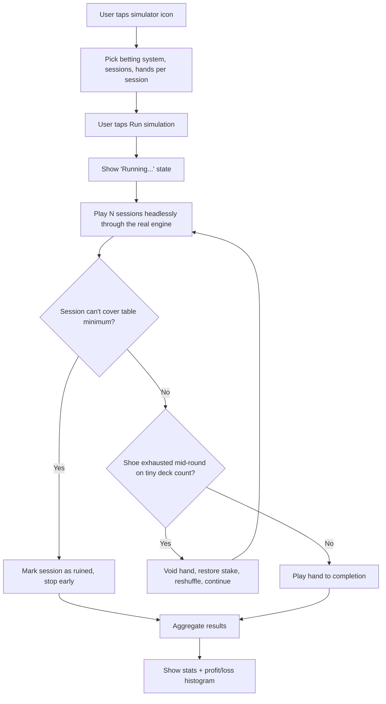

---

## Feature: Out of Chips / Re-buy
Goal: Recover after busting out of chips.

Flow:
1. User does: (No action — triggered automatically.)
   - App responds by: Once the bankroll drops below the table minimum during the betting phase, `isBroke()` becomes true ([game.js:327-329](../src/engine/game.js)).
   - Result: The chip tray and Deal button are replaced with an "Out of chips." message and a "Re-buy $X" button ([render.js:248-253](../src/ui/render.js)).
2. User does: Taps "Re-buy $X".
   - App responds by: `rebuy()` resets the bankroll to the table's configured starting amount ([game.js:332-336](../src/engine/game.js)).
   - Result: Normal betting controls return.

Decision points:
- Re-buy only takes effect during the betting phase and only while actually broke; the function is a no-op otherwise.

Possible errors or edge cases:
- None — there's no limit on how many times a player can re-buy.

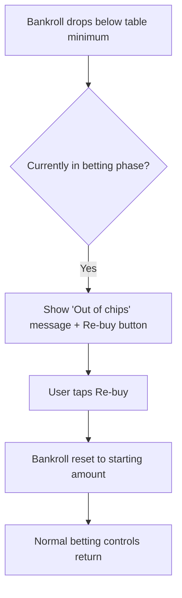

---

## Needs confirmation
- Whether the rule options the capability guard currently flags as unsupported — early surrender, continuous shuffle, European no-peek dealing, re-splitting Aces, hitting split Aces, and non-Hi-Lo counting systems — are planned for a future release, or are permanently out of scope for this app. The code only documents them as "not implemented in Phase 1" without naming a target phase.
- (No other genuinely ambiguous behavior was found — every flow above traces to specific, readable engine logic.)

## Suggested next documentation
1. **A storage/data reference for the IndexedDB save data** — the app persists exactly one record (key `"state"`) holding `bankrollCents` and the `settings` object ([src/persistence/persist.js](../src/persistence/persist.js)); a short reference of that shape (and when it's written vs. left stale on an interrupted hand) would help anyone debugging "my progress didn't save."
2. **A deployment/hosting walkthrough for the still-pending Phase 6** — the README notes the PWA install/offline features need HTTPS hosting and real-device verification on Android and iOS, which hasn't happened yet.
3. **A "how the strategy math works" explainer** for a more technical reader — covering the dealer-odds → expected-value → advisor pipeline in `src/teaching/`, including the documented caveat that the closest decisions (e.g. a soft 13 vs. a dealer 5) can sit within about a hundredth of a point of EV and may disagree with a printed chart on that single cell.
